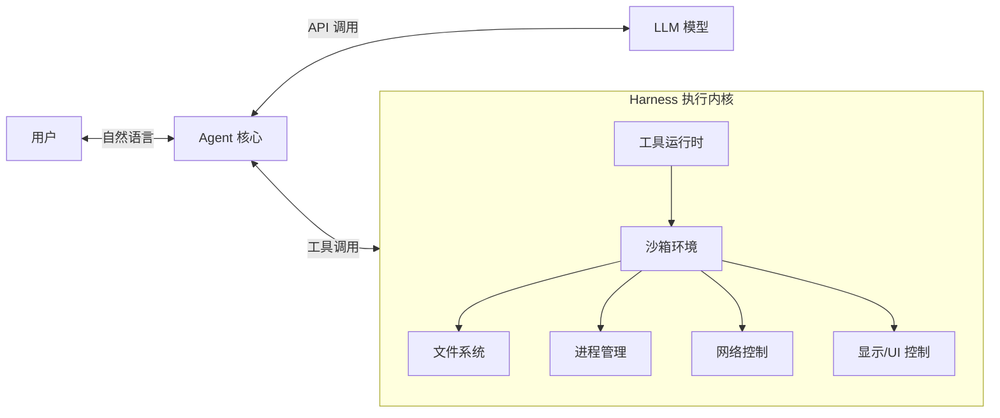
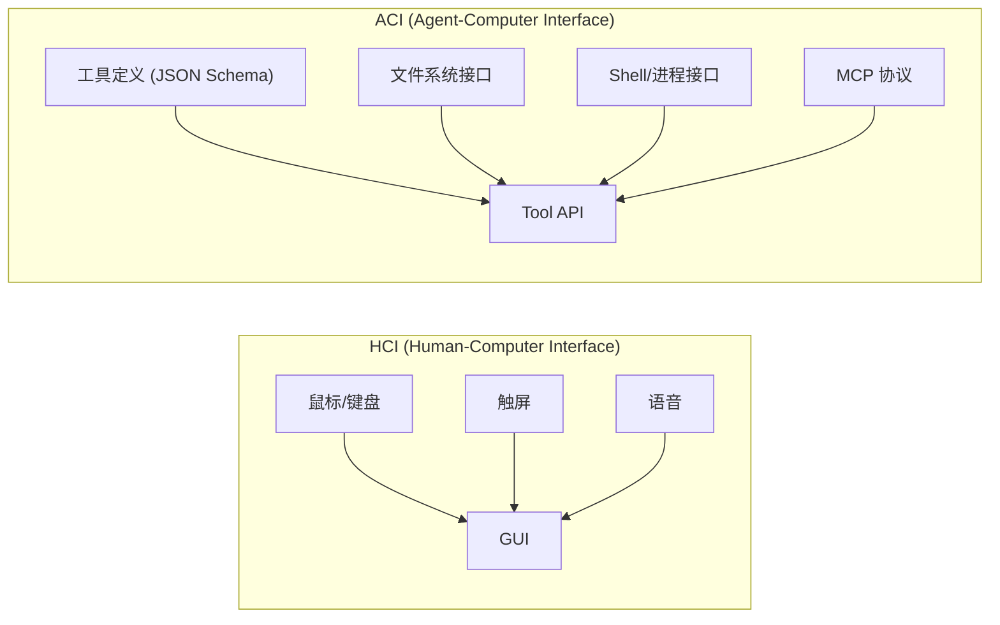
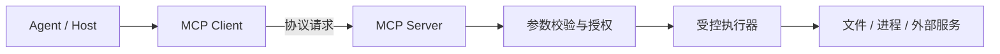
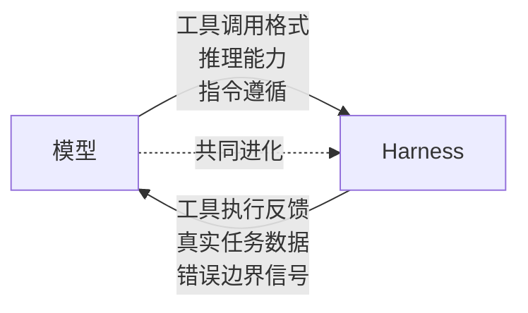



## 引言

模型能够生成工具调用，并不意味着系统已经具备可靠执行任务的能力。文件访问是否越权、命令是否按预期运行、失败后如何清理，以及结果如何交还模型，都需要模型之外的运行系统负责。

本文把 **Harness** 定义为围绕模型组织工具执行、权限检查、资源限制、状态记录与结果反馈的工程层。`Model + Harness = Agent` 可以作为概念简写，但它不是安全性或可靠性的证明。

### 问题与阅读指南

本文回答三个问题：执行权限由谁落实，工具接口如何减少歧义，以及执行反馈如何用于改进系统。首先区分不同隔离机制，再讨论 ACI 与 MCP，最后分析模型与运行系统的反馈闭环。读者只需了解基本的工具调用和操作系统进程概念；后续的 Subagent 委派讨论建立在这些边界之上。

## Harness 的架构定位

### Harness 在 Agent 架构中的位置



Harness 不是 Agent 的一个"功能模块"，而是 **Agent 运行的基础设施层**。它定义了 Agent 能做什么、不能做什么、以及如何安全地做。

### Harness 的核心职责

| 职责 | 说明 | 技术挑战 |
|------|------|---------|
| 工具执行 | 安全地运行 Agent 调用的工具 | 隔离性 vs 可用性 |
| 资源管理 | CPU/内存/磁盘/网络的配额控制 | 粒度与性能的平衡 |
| 状态管理 | 文件系统、环境变量、会话状态 | 持久化与回滚 |
| 安全边界 | 防止恶意代码执行、数据泄露 | 纵深防御 |
| 可观测性 | 日志、指标、追踪 | 低开销审计 |

## 执行隔离机制与威胁模型

### 为什么需要沙箱

Agent 执行的代码来自两个来源：
1. **预定义的工具**：开发者编写的，相对可信
2. **模型生成的代码**：模型动态生成的 Shell 命令、Python 脚本等——**完全不可信**

不加限制地执行破坏性命令或下载后直接运行脚本，可能损坏文件或泄露数据。即使工具本身由开发者编写，其输入、配置和所处理的数据也可能不可信；沙箱与授权需要共同约束执行。

### 三类机制，而不是自动升级的安全等级

| 机制 | 提供的边界 | 仍需明确的条件 |
|------|------------|----------------|
| 进程约束 | seccomp 缩小系统调用面；Landlock 等机制限制可访问资源 | 独立进程本身不限制同一用户的文件和网络权限；过滤器与资源策略必须实际装载 |
| 容器 | namespaces 组织视图，cgroups 管理资源，结合权限与挂载策略约束进程 | 常见容器共享宿主内核；特权模式、宿主挂载、凭据和网络配置可能扩大访问面 |
| 虚拟机 / microVM | 通过虚拟化提供独立客体内核边界 | 仍需限制共享目录、网络出口、凭据和宿主控制接口 |

Firecracker 属于基于 KVM 的 microVM 技术，而非普通容器运行时。[Firecracker 官方说明](https://firecracker-microvm.github.io/)

这些机制可以组合。不能仅凭名称给出“低 / 中 / 高”的绝对安全分数，也不能脱离工作负载和测量条件给出固定开销百分比。选择时应先说明威胁模型：代码是否可信、有哪些秘密、允许哪些外部副作用，以及攻击者是否能并发修改文件系统。

### seccomp 与 Landlock 的职责边界

seccomp 过滤器检查系统调用编号及参数，但不能解引用参数指针来读取文件路径字符串，因此它不是路径白名单机制，也不是完整沙箱。[Linux seccomp 文档](https://docs.kernel.org/userspace-api/seccomp_filter.html)

Landlock 是另一类访问控制机制：程序创建规则集、加入允许规则并实际限制自身；是否支持所需操作取决于内核配置与 ABI。实现应检测支持情况，遇到必需限制无法启用时拒绝执行，而不是静默退化。[Linux Landlock 文档](https://docs.kernel.org/userspace-api/landlock.html)

Python 标准库没有 `os.landlock_restrict_self(allowed_paths=...)` 这样的便捷接口。把规则写成字符串也不会自动装载 seccomp 过滤器。因此本文不把几行 Python 包装命令称为“安全沙箱”。生产执行器应使用经过审查的运行时，并验证以下顺序：

1. 在独立执行环境中配置文件挂载、身份、网络和资源限额。
2. 装载实际可用的访问控制与系统调用策略；失败即停止。
3. 按明确的参数结构执行任务，限制时间和输出，并记录退出状态。
4. 超时或取消后停止所拥有的子进程，清理临时资源，核对外部副作用。

禁止 `execve` 的策略与“随后启动 Shell”也不能直接同时成立；限制的装载时机必须与运行时启动过程协调。

## ACI：Agent-Computer Interface

### ACI 的概念

ACI（Agent-Computer Interface）关注 **Agent 与计算机交互时的接口设计**。2024 年的 SWE-agent 论文已明确使用这一概念，并研究文件浏览、编辑和测试接口如何影响模型行为；不能将其起源归于“2025 年底 Anthropic”。[SWE-agent 原始论文](https://arxiv.org/abs/2405.15793)

以下原则是工程设计建议，不是某一协议强制规定的规范。



### ACI 设计原则

**原则 1：最小接口表面积**
每个工具只暴露必要参数。是否拆分取决于任务语义与参数依赖，不能仅按参数数量判断。

**原则 2：自描述性**
工具的输入输出应尽量自描述，帮助模型从工具定义理解用法；复杂约束仍需明确文档和运行时校验。

**原则 3：幂等性优先**
优先设计幂等操作。重复提交同一个操作应避免产生重复副作用；通常需要请求标识、版本前置条件或幂等键。`create_or_update` 的名称本身不保证幂等，也可能意外覆盖其他人的更新。

**原则 4：错误可恢复**
错误消息应包含**可操作的信息**，例如授权范围内、必要且脱敏的候选路径或修复建议；不应为了帮助恢复而暴露未授权目录、凭据或其他敏感信息。

**原则 5：原子性**
明确一个调用的提交边界。封装多个步骤并不会自动获得原子性；跨服务操作需要事务、补偿动作，或返回“部分完成”的可核查状态。

### 工具设计的反模式

以下是接口形状的伪代码，不是可直接运行的实现；真实接口还需参数校验、授权和并发控制。

```text
# ❌ 反模式1：过大的接口表面积
def manage_cloud_resource(action, resource_type, region, config, tags, ...):
    ...

# ✅ 改进：拆分为专注的工具
def create_vm(region, machine_type, image): ...
def delete_vm(vm_id): ...
def list_vms(region, status_filter): ...

# ❌ 反模式2：不可恢复的错误
raise Exception("Operation failed")

# ✅ 改进：可操作的错误
return {
    "error": "VM creation failed: quota exceeded",
    "current_quota": 10,
    "used": 10,
    "suggestion": "Delete unused VMs or request quota increase at /admin/quotas"
}

# ❌ 反模式3：非幂等的创建
def create_file(path, content): ...  # 重复调用会失败

# ✅ 改进：幂等操作
def write_file(path, content, expected_version): ...  # 检查版本，避免覆盖并发更新
```

## MCP：连接工具的协议，不是安全沙箱

MCP 定义 Host、Client 与 Server 之间的交互方式，使工具和上下文资源能够以统一协议被发现和调用。它不规定整个 Agent 的规划、上下文管理或执行隔离策略；MCP Server 可以成为 Harness 的组件，但不能等同于完整 Harness。[MCP 架构说明](https://modelcontextprotocol.io/docs/learn/architecture)



协议连通只解决“如何调用”，不回答“是否允许调用”。认证、每项操作的授权、执行沙箱、输出限额和审计仍须由相应层实现。工具声明中的白名单，也不能阻止已获准的通用解释器通过参数执行任意代码。

### 教学示例：路径包含关系检查

下面是 **可运行的路径校验练习，不是生产安全边界**（Python 3.10+）。假设目录树不会被攻击者并发改动，只读取已有的普通文件。它拒绝绝对路径、父目录越界、同名前缀目录，以及解析后指向目录外的符号链接；读取大小也有上限。

```python
from pathlib import Path


def read_workspace_file(workspace: str, relative_path: str,
                        max_bytes: int = 65536) -> str:
    if max_bytes < 0:
        raise ValueError("max_bytes must be non-negative")
    root = Path(workspace).resolve(strict=True)
    requested = Path(relative_path)
    if requested.is_absolute():
        raise ValueError("absolute path denied")
    target = (root / requested).resolve(strict=True)
    if not target.is_relative_to(root):
        raise ValueError("outside workspace")
    if not target.is_file():
        raise ValueError("regular file required")
    with target.open("rb") as stream:
        data = stream.read(max_bytes + 1)
    if len(data) > max_bytes:
        raise ValueError("file too large")
    return data.decode("utf-8")
```

`str(target).startswith(str(root))` 不足以判断目录归属：`/tmp/workspace-other` 也具有 `/tmp/workspace` 前缀。`resolve()` 与路径组件判断可以避免这一类错误，但 **检查后、打开前仍存在 TOCTOU 竞争窗口**；具有目录写权限的对手可以替换路径。因此该示例不适用于恶意并发环境，也不能控制后续命令的文件访问。路径归属也不能证明内容可信：硬链接、挂载和工作区内部的敏感文件仍需独立策略。

生产实现应根据平台使用基于目录文件描述符的受约束打开方式、核对打开后的文件类型，并在操作系统层限制可见文件和权限。不要把通用 `run_command(command, args)` 加一个命令名列表就称为安全执行器：`python`、`sh`、`git` 等工具的参数、配置或钩子都可能扩展实际能力。真正的命令执行还需要独立运行时边界。

## Harness 与模型的共同进化

### 从单向适配到反馈闭环

运行系统不仅适配模型的工具调用格式，也能记录执行错误、延迟和验证结果，用于调整接口、提示和评测；具备相应训练条件时，还可以构造模型训练数据。这是一种设计方向，不意味着任何具体团队已经实现了全部机制。



### 共同进化的具体机制

| 机制 | 说明 | 实例 |
|------|------|------|
| **工具定义微调** | 用 Harness 中工具的实际使用数据微调模型 | 模型学会更准确地选择参数 |
| **错误恢复训练** | 用 Harness 收集的错误-修复对训练模型 | 模型学会从工具错误中恢复 |
| **延迟感知路由** | Harness 反馈不同工具的实际延迟，模型学会规划最优调用顺序 | 先调用快的工具验证假设 |
| **安全边界学习** | 模型学习权限规则，减少无效尝试，但不能替代强制授权 | 统计越权请求与拒绝后的恢复行为 |

## 总结

Harness Engineering 关注模型之外的执行系统，是 Agent 工程中连接能力、权限与反馈的重要部分。它的核心问题可以归结为三个：

1. **安全性**：如何在不可信代码执行与系统完整性之间找到平衡？（按威胁模型组合隔离机制）
2. **可用性**：如何让工具接口对 LLM 友好，减少调用失败？（ACI 设计原则）
3. **可进化性**：如何让 Harness 与模型形成正向反馈循环？（共同进化）

理解了 Harness，你才真正理解了 "Model + Harness = Agent" 这个等式中，另一半的工程内涵。

---

## 参考文献

<ol class="references">
<li>Yang et al. SWE-agent: Agent-Computer Interfaces Enable Automated Software Engineering. 2024. <a href="https://arxiv.org/abs/2405.15793">原始论文</a></li>
<li>Model Context Protocol. <a href="https://modelcontextprotocol.io/docs/learn/architecture">Architecture overview</a></li>
<li>Linux Kernel. <a href="https://docs.kernel.org/userspace-api/landlock.html">Landlock: unprivileged access control</a></li>
<li>Linux Kernel. <a href="https://docs.kernel.org/userspace-api/seccomp_filter.html">Seccomp BPF</a></li>
<li>Firecracker. <a href="https://firecracker-microvm.github.io/">官方项目说明</a></li>
</ol>


