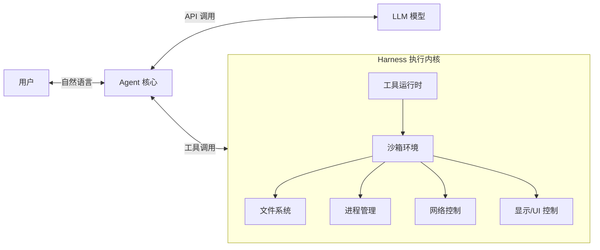
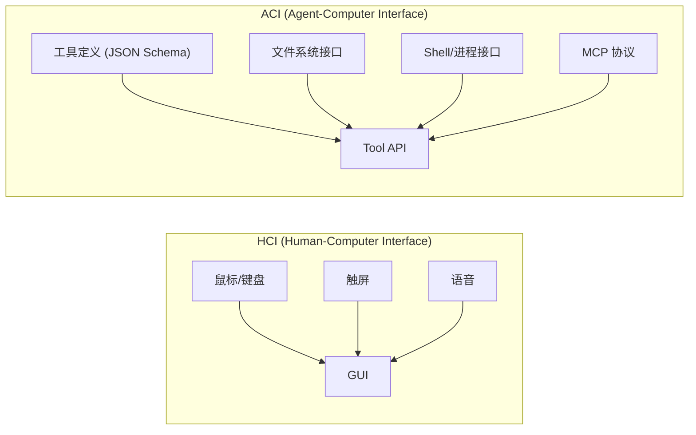
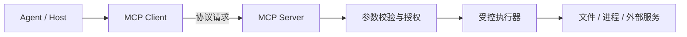



## 引言

模型能够生成工具调用，并不意味着系统已经具备可靠执行任务的能力。文件访问是否越权、命令是否按预期运行、失败后如何清理，以及结果如何交还模型，都需要模型之外的运行系统负责。

本文把 **Harness** 定义为围绕模型组织工具执行、权限检查、资源限制、状态记录与结果反馈的工程层。`Model + Harness = Agent` 可以作为概念简写，但它不是安全性或可靠性的证明。

### 问题与阅读指南

本文回答三个问题：执行权限由谁落实，失败后怎样知道动作是否已经发生，以及工具接口怎样改变模型的搜索与纠错轨迹。先区分隔离机制，再以版本化写入推导执行契约，最后用已有 ACI 消融研究讨论如何验证设计。读者只需了解基本的工具调用和操作系统进程概念；后续的 Subagent 委派讨论建立在这些边界之上。

## Harness 的架构定位

### Harness 在 Agent 架构中的位置



Harness 不是 Agent 的一个"功能模块"，而是 **Agent 运行的基础设施层**。它定义了 Agent 能做什么、不能做什么、以及如何安全地做。

### Harness 的核心职责

| 职责 | 说明 | 技术挑战 |
|------|------|---------|
| 工具执行 | 安全地运行 Agent 调用的工具 | 隔离性 vs 可用性 |
| 资源管理 | CPU/内存/磁盘/网络的配额控制 | 粒度与性能的平衡 |
| 状态管理 | 文件系统、环境变量、会话状态 | 持久化与回滚 |
| 安全边界 | 防止恶意代码执行、数据泄露 | 纵深防御 |
| 可观测性 | 日志、指标、追踪 | 低开销审计 |

## 执行隔离机制与威胁模型

### 为什么需要沙箱

Agent 执行的代码来自两个来源：
1. **预定义的工具**：开发者编写的，相对可信
2. **模型生成的代码**：模型动态生成的 Shell 命令、Python 脚本等——**完全不可信**

不加限制地执行破坏性命令或下载后直接运行脚本，可能损坏文件或泄露数据。即使工具本身由开发者编写，其输入、配置和所处理的数据也可能不可信；沙箱与授权需要共同约束执行。

### 三类机制，而不是自动升级的安全等级

| 机制 | 提供的边界 | 仍需明确的条件 |
|------|------------|----------------|
| 进程约束 | seccomp 缩小系统调用面；Landlock 等机制限制可访问资源 | 独立进程本身不限制同一用户的文件和网络权限；过滤器与资源策略必须实际装载 |
| 容器 | namespaces 组织视图，cgroups 管理资源，结合权限与挂载策略约束进程 | 常见容器共享宿主内核；特权模式、宿主挂载、凭据和网络配置可能扩大访问面 |
| 虚拟机 / microVM | 通过虚拟化提供独立客体内核边界 | 仍需限制共享目录、网络出口、凭据和宿主控制接口 |

Firecracker 属于基于 KVM 的 microVM 技术，而非普通容器运行时。[Firecracker 官方说明](https://firecracker-microvm.github.io/)

这些机制可以组合。不能仅凭名称给出“低 / 中 / 高”的绝对安全分数，也不能脱离工作负载和测量条件给出固定开销百分比。选择时应先说明威胁模型：代码是否可信、有哪些秘密、允许哪些外部副作用，以及攻击者是否能并发修改文件系统。

### seccomp 与 Landlock 的职责边界

seccomp 过滤器检查系统调用编号及参数，但不能解引用参数指针来读取文件路径字符串，因此它不是路径白名单机制，也不是完整沙箱。[Linux seccomp 文档](https://docs.kernel.org/userspace-api/seccomp_filter.html)

Landlock 是另一类访问控制机制：程序创建规则集、加入允许规则并实际限制自身；是否支持所需操作取决于内核配置与 ABI。实现应检测支持情况，遇到必需限制无法启用时拒绝执行，而不是静默退化。[Linux Landlock 文档](https://docs.kernel.org/userspace-api/landlock.html)

Python 标准库没有 `os.landlock_restrict_self(allowed_paths=...)` 这样的便捷接口。把规则写成字符串也不会自动装载 seccomp 过滤器。因此本文不把几行 Python 包装命令称为“安全沙箱”。生产执行器应使用经过审查的运行时，并验证以下顺序：

1. 在独立执行环境中配置文件挂载、身份、网络和资源限额。
2. 装载实际可用的访问控制与系统调用策略；失败即停止。
3. 按明确的参数结构执行任务，限制时间和输出，并记录退出状态。
4. 超时或取消后停止所拥有的子进程，清理临时资源，核对外部副作用。

禁止 `execve` 的策略与“随后启动 Shell”也不能直接同时成立；限制的装载时机必须与运行时启动过程协调。

## ACI：Agent-Computer Interface

### ACI 的概念

ACI（Agent-Computer Interface）关注 **Agent 与计算机交互时的接口设计**。2024 年的 SWE-agent 论文已明确使用这一概念，并研究文件浏览、编辑和测试接口如何影响模型行为；不能将其起源归于“2025 年底 Anthropic”。[SWE-agent 原始论文](https://arxiv.org/abs/2405.15793)

以下原则是工程设计建议，不是某一协议强制规定的规范。



### 从“写文件”推导执行契约：版本控制不等于重复请求识别

考虑一个最小场景：模型读到文档版本 v7，要求写入补丁 P；服务器已成功写成 v8，但响应在网络中丢失。模型只看到超时。接下来应该重试、读取，还是报告失败？这比“工具应该幂等”更接近 Harness 必须回答的问题。

| 接口选择 | 能解决的问题 | 同一故障下的缺口 |
| --- | --- | --- |
| `write(path, content)` | 表达最终内容 | 重试可能覆盖他人在 v8 后的修改 |
| `write(path, content, expected_version=7)` | 比较并交换（CAS），拒绝基于旧版本的新修改 | 原请求重试也会因当前已是 v8 而冲突；调用者仍不知道第一次是否成功 |
| 再加入 `operation_id` 与请求摘要 | 区分“同一动作的重传”和“另一个基于旧状态的动作” | 必须保存结果并约定保留期；ID 重用、丢失或跨服务写入仍需处理 |

本文建议的局部协议是：先认证请求主体，并确认其仍有权读取该操作所属任务与资源范围，再在对应操作命名空间中查账本；不可让猜中 ID 的人取得其他主体的回执。若同一 ID 已存在，且载荷摘要及原始 expected_version 均一致，返回原操作的结果；同一 ID 却对应不同参数则拒绝。只有新 ID 才检查目标版本，满足前置条件后应用写入，并记录新版本与结果。**“重传是不是同一个动作”与“新动作的依据是否过时”是两个维度，检查顺序也不同。** 返回旧操作的 v8 回执，不意味着当前文档仍是 v8；后续编辑仍要读取当前版本。

这里要求“写入对象”和“记录操作结果”位于同一提交边界。若文件写成功后进程崩溃、账本还未落盘，重试仍无法靠账本确认。这时可选的方案包括把对象与账本放入同一事务存储，或采用暂存对象、内容标识与显式提交记录；不是再包一层 `try/except` 就能获得原子性。对于远端邮件、发布等操作，本地事务无法覆盖对方服务，须使用对方支持的幂等键或查询接口；无法核实时应保留 `unknown`，而不是把超时写成 `failed`。

### 可信执行不是一个布尔返回值

一个有用的结果契约至少区分下列阶段。它们描述本文的设计建议，而不是某个产品已有的标准状态机。

| 状态 | 可证明的事实 | 下一步依据 |
| --- | --- | --- |
| rejected | 执行前置检查未通过，尚未派发 | 缩小范围、重新读取或取得所需授权 |
| accepted / running | 操作已被接收或执行中 | 使用操作 ID 查询；不能交付为完成 |
| succeeded | 指定目标与版本的效果已得到确认 | 将回执作为该操作的证据 |
| failed-before-effect | 有证据表明没有产生目标副作用 | 按错误类型决定是否可重试 |
| unknown-effect | 超时、断连等使效果不确定 | 对账、等待或人工处理；不要盲目重复 |

把这些状态映射到真实执行器，需要分开观察三个对象：工具进程是否退出、目标资源是否改变、任务验收是否通过。命令退出码为 0 只直接回答第一个问题的一部分；例如构建脚本正常结束，不代表它构建的是当前提交。反过来，客户端退出也不证明服务端没有完成请求。

授权检查与实际提交之间同样可能发生变化。若权限在排队期间被撤销，仅在入队时检查就不够；应在不可逆提交前重新确认当前授权及目标版本。系统需要定义这一检查与动作的边界，而不能承诺跨所有外部系统的瞬时撤销。Harness 的职责是把这些限制转换成可观察状态和可执行前置条件，上层再决定等待、重试或改变计划。

### 一个局部可验证的账本实验

仓库的 [examples/agent_tradeoffs](https://github.com/YangCazz/YangCazz.github.io/tree/main/examples/agent_tradeoffs) 提供纯 Python、单进程的操作账本模型。实验比较同一版本上的两种请求：同 ID 重传返回原结果，新 ID 的旧版本请求则冲突；还注入提交前中断和提交后丢失响应。后者再次提交时，模型中的效果计数只能增加一次。

可在仓库根目录复核：

```bash
python3 examples/agent_tradeoffs/tradeoffs.py
python3 -m unittest discover -s examples/agent_tradeoffs -v
```

本次运行中，丢失响应后用同一请求重传，输出为 `version=1, receipts=1, same_receipt=True`；换一个新 ID 仍带旧版本则被拒绝。前者识别已提交操作，后者保护当前对象，二者不是同一种“成功”。

这个实验验证的是**一个原子内存状态转换内部**的协议性质，不执行文件写入或远端发布，也没有测量真实崩溃恢复。它故意把跨系统缺口留在模型之外：如果实际存储不能原子地提交效果与账本，这个局部性质就不能直接迁移。实现细节和断言见随文测试，而不是把示例命名为“生产级执行器”。

## MCP：连接工具的协议，不是安全沙箱

MCP 定义 Host、Client 与 Server 之间的交互方式，使工具和上下文资源能够以统一协议被发现和调用。它不规定整个 Agent 的规划、上下文管理或执行隔离策略；MCP Server 可以成为 Harness 的组件，但不能等同于完整 Harness。[MCP 架构说明](https://modelcontextprotocol.io/docs/learn/architecture)



协议连通只解决“如何调用”，不回答“是否允许调用”。认证、每项操作的授权、执行沙箱、输出限额和审计仍须由相应层实现。工具声明中的白名单，也不能阻止已获准的通用解释器通过参数执行任意代码。

### 教学示例：路径包含关系检查

下面是 **可运行的路径校验练习，不是生产安全边界**（Python 3.10+）。假设目录树不会被攻击者并发改动，只读取已有的普通文件。它拒绝绝对路径、父目录越界、同名前缀目录，以及解析后指向目录外的符号链接；读取大小也有上限。

```python
from pathlib import Path


def read_workspace_file(workspace: str, relative_path: str,
                        max_bytes: int = 65536) -> str:
    if max_bytes < 0:
        raise ValueError("max_bytes must be non-negative")
    root = Path(workspace).resolve(strict=True)
    requested = Path(relative_path)
    if requested.is_absolute():
        raise ValueError("absolute path denied")
    target = (root / requested).resolve(strict=True)
    if not target.is_relative_to(root):
        raise ValueError("outside workspace")
    if not target.is_file():
        raise ValueError("regular file required")
    with target.open("rb") as stream:
        data = stream.read(max_bytes + 1)
    if len(data) > max_bytes:
        raise ValueError("file too large")
    return data.decode("utf-8")
```

`str(target).startswith(str(root))` 不足以判断目录归属：`/tmp/workspace-other` 也具有 `/tmp/workspace` 前缀。`resolve()` 与路径组件判断可以避免这一类错误，但 **检查后、打开前仍存在 TOCTOU 竞争窗口**；具有目录写权限的对手可以替换路径。因此该示例不适用于恶意并发环境，也不能控制后续命令的文件访问。路径归属也不能证明内容可信：硬链接、挂载和工作区内部的敏感文件仍需独立策略。

生产实现应根据平台使用基于目录文件描述符的受约束打开方式、核对打开后的文件类型，并在操作系统层限制可见文件和权限。不要把通用 `run_command(command, args)` 加一个命令名列表就称为安全执行器：`python`、`sh`、`git` 等工具的参数、配置或钩子都可能扩展实际能力。真正的命令执行还需要独立运行时边界。

## ACI 的价值要沿行为轨迹验证，而非按工具数量判断

SWE-agent 的意义不只是提出 ACI 名称，还在于把接口设计作为可比较的变量。在论文 v3 的 SWE-bench Lite、GPT-4 设置中，Table 3 报告如下解决率；这是原作者实验，本文未复现，也不把它推广为所有模型的最优配置。[原始消融与轨迹分析](https://arxiv.org/html/2405.15793v3#S5.SS1)

| 设计对照 | 报告解决率 | 值得追问的机制 |
| --- | --- | --- |
| 汇总搜索 / 逐条搜索 / 无搜索工具 | 18.0% / 12.0% / 15.7% | 逐条浏览可能诱导反复翻页，消耗行动预算 |
| 100 行查看窗口 / 整文件查看 | 18.0% / 12.7% | 更多可见文本不一定带来更好的定位 |
| 编辑并检查 lint / 仅编辑 | 18.0% / 15.0% | 拒绝引入 lint 错误能改变后续纠错轨迹 |

这些结果使“接口越丰富越好”成为一个可被反驳的主张。真正的设计对象不仅是参数 schema，还包括一次观察的粒度、错误后的可选动作，以及模型会不会陷入低收益循环。lint 只能拦住某类编辑错误，不能证明功能正确；缩短查看窗口也可能增加跨文件理解所需的调用。因此不应把上表改写成“固定 100 行、所有编辑都 lint”的普遍规范。

### 如何区分接口改进与预算增加

本文建议用同一组任务、模型版本、初始仓库和总预算做配对比较，每次只改变一个接口因素。例如比较“整文件返回”和“定位片段加续读入口”，同时记录最终测试、工具调用数、无效重复动作、输出 token 与恢复耗时。若片段接口只是触发更多调用，其局部 token 节省可能被往返成本抵消；若错误更早暴露，应能在轨迹中找到错误级联变短的证据。

还应把三种失败分开统计：模型提出不合法请求、运行时错误地允许请求、合法执行却未达到任务目标。它们分别指向接口理解、强制边界和任务能力，混成一个“成功率”会让改进失焦。下一版模型更擅长某个接口，也不意味着可以撤去操作系统权限控制。

由此，所谓 Harness 与模型共同改进，首先应是一条可复核的工程回路：**提出行为假设 → 固定其他条件修改接口 → 检查轨迹与最终效果 → 保留或否决改动**。积累数据后可以研究训练，但没有训练实验时，不应把“未来可用于微调”当作已证明的能力。

## 总结

Harness Engineering 关注模型之外的执行系统，是 Agent 工程中连接能力、权限与反馈的重要部分。它的核心问题可以归结为三个：

1. **安全性**：如何在不可信代码执行与系统完整性之间找到平衡？（按威胁模型组合隔离机制）
2. **可用性**：如何让工具接口对 LLM 友好，减少调用失败？（ACI 设计原则）
3. **可验证性**：接口是否改变了错误轨迹与最终成果，而不只是增加调用或 token？（受控比较）

本篇的边界是一次动作的可信执行。接下来的 [Subagent 架构]() 把问题提高一层：多个执行者的产物怎样在共享目标下组合，而不把局部成功误当成整体成功。

---

## 参考文献

<ol class="references">
<li>Yang et al. SWE-agent: Agent-Computer Interfaces Enable Automated Software Engineering. 2024. <a href="https://arxiv.org/abs/2405.15793">原始论文</a></li>
<li>Model Context Protocol. <a href="https://modelcontextprotocol.io/docs/learn/architecture">Architecture overview</a></li>
<li>Linux Kernel. <a href="https://docs.kernel.org/userspace-api/landlock.html">Landlock: unprivileged access control</a></li>
<li>Linux Kernel. <a href="https://docs.kernel.org/userspace-api/seccomp_filter.html">Seccomp BPF</a></li>
<li>Firecracker. <a href="https://firecracker-microvm.github.io/">官方项目说明</a></li>
</ol>


