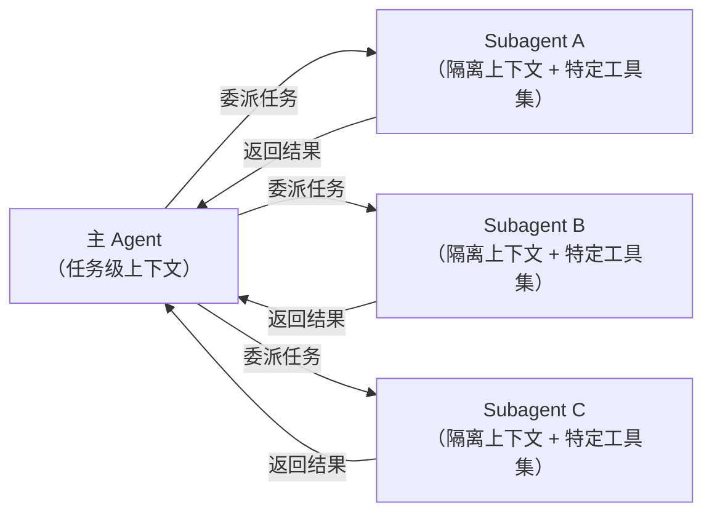
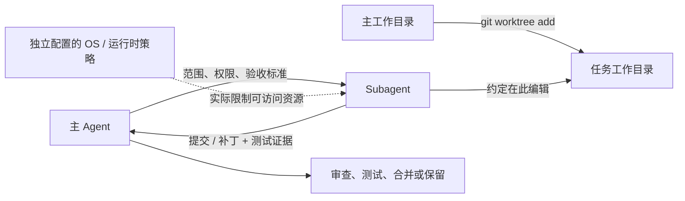
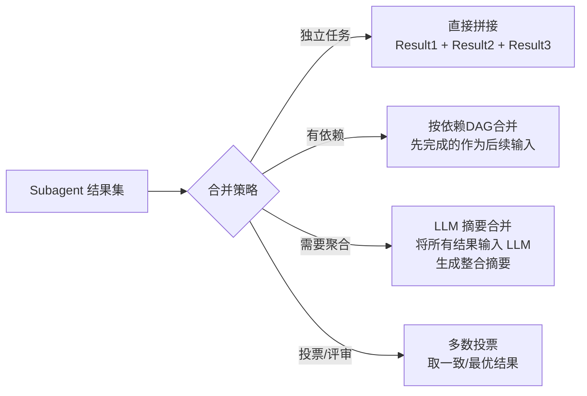
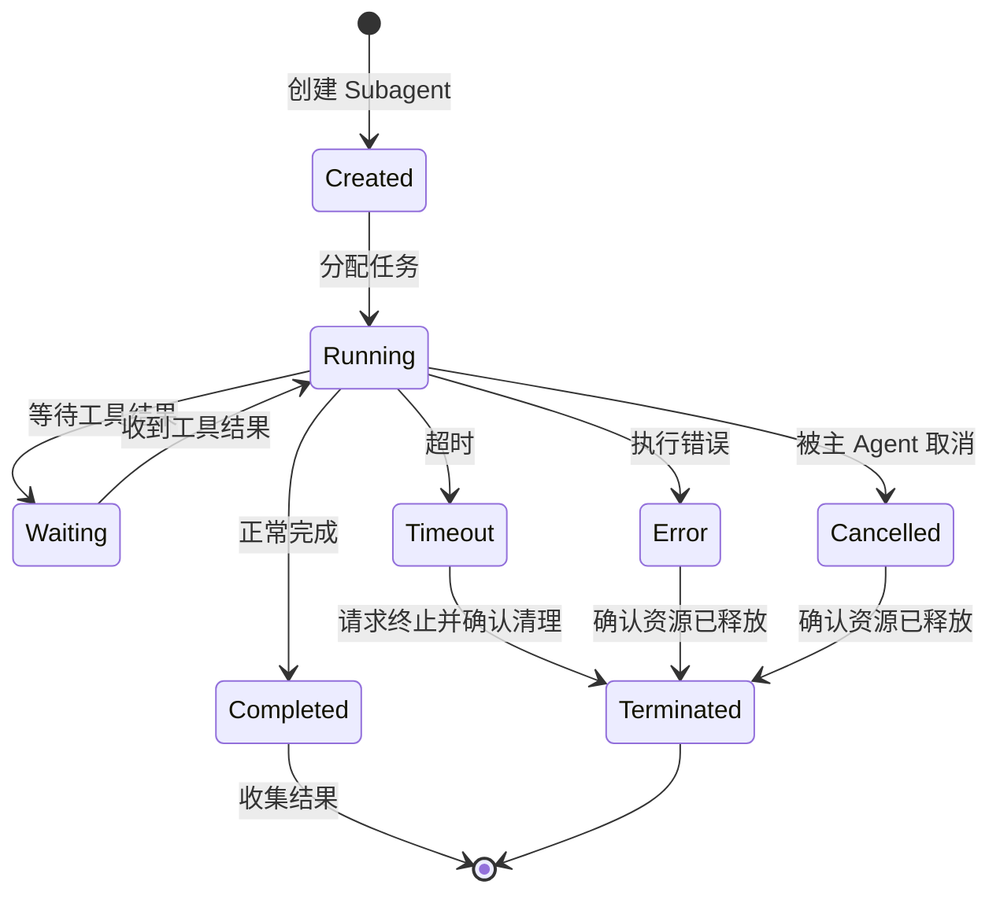



## 引言

在你的 Agent 同时处理"搜索文档、审查代码、更新测试、部署预览"四个任务时，如果只用一个主 Agent 按顺序执行，不仅慢，而且上下文窗口会迅速膨胀。

**Subagent** 是一种委派模式：主 Agent 将有边界的任务交给具有独立执行上下文的子代理，再接收其结果。它可以减少主上下文中的中间信息；只有任务可并行且协调成本可控时，才可能缩短总用时。

Subagent 可以视为多 Agent 系统的一种层次化组织形式，而不是与 Multi-Agent 互斥的类别。本文比较的是“主从委派”和“同级协作”两种控制结构。

### 问题与阅读指南

本文围绕三个问题展开：子代理可以看见什么、可以修改什么，以及失败后谁负责收尾。先定义委派关系，再区分上下文、工作副本和操作系统权限，最后讨论结果收集、取消与资源清理。建议先理解 Harness 的工具授权和运行时边界；本文不把子代理数量、工作目录或一个超时参数视为安全保证。

## Subagent 的多维定义

### 什么算一个 Subagent

不同框架的命名并不完全一致。本文用以下三项描述子代理的设计契约，而不把它们当作所有产品都满足的定义：



1. **上下文隔离**：Subagent 拥有独立的上下文窗口，减少主上下文的中间信息；返回结果仍需校验
2. **工具限制**：应按子任务授予最小工具权限，并由运行时执行授权，而不是仅靠提示词约束
3. **明确生命周期**：有清晰的创建、执行、返回、销毁过程

### 主从委派与同级协作

| 维度 | 主从委派（本文的 Subagent 模式） | 同级协作模式 |
|------|---------------------|----------------------|
| 控制流 | 以委派与收集为主，也可有中间消息 | 以协作、协商为主 |
| 上下文 | 通常分开维护，按契约返回结果或中间信息 | 可共享，也可分别维护并传递消息 |
| 决策权 | 主 Agent 负责整体决策，子代理可在授权范围内自主行动 | 按协调协议分配 |
| 并行性 | 独立子任务可以并行，依赖任务仍需排序 | 取决于依赖关系与协调方式 |
| 适用场景 | 独立子任务分解 | 需要相互审查/辩论的任务 |

## 隔离模型

### 三个相互独立的隔离维度

| 维度 | 解决的问题 | 不提供的保证 |
|------|------------|--------------|
| 上下文隔离 | 控制子代理输入和回传信息的范围，减少中间日志占用 | 不阻止工具读取共享磁盘，不自动防止提示注入或泄密 |
| 工作副本隔离 | 将不同任务的源文件修改放在不同目录或分支 | 不限制进程访问目录外的文件、网络或凭据 |
| 执行权限隔离 | 由操作系统或运行时约束文件、网络、进程与资源访问 | 不保证任务正确，也不替代输出审查与外部副作用管理 |

这些维度需要分别配置，而不是从“独立上下文”自然升级到“安全沙箱”。单独启动一个进程不会自动削减其权限；容器也不会自动断网或获得独立内核。需要运行不可信代码时，应先按 Harness 的威胁模型选择并验证执行边界。

### Git worktree：工作副本隔离，不是进程沙箱

Git worktree 允许一个仓库关联多个工作目录；每个工作树有自己的索引与 `HEAD` 等状态，但共享仓库对象和部分引用。这适合把并行任务的改动分开管理。[Git worktree 官方文档](https://git-scm.com/docs/git-worktree)



关键边界如下：

- **改动分离**：在各自工作树内的普通源文件编辑不会直接改写另一工作树的对应文件，但合并仍可能发生冲突。
- **不是权限隔离**：工作目录设置不阻止进程通过绝对路径访问主仓库、用户目录、共享凭据或网络。
- **不是副作用回滚**：删除工作树不能撤回已发送消息、已部署服务、数据库写入或工作树外的文件改动。
- **不是共享资源互斥**：Git 公共元数据、端口、数据库和缓存仍可能需要协调。

Claude Code 的子代理提供独立上下文与工具权限配置，但这些配置应与实际运行环境一起核查，不能从“使用 worktree”推导出“仅能看见 worktree”。产品接口会变化，部署时应核对对应版本文档。[Claude Code 子代理文档](https://code.claude.com/docs/en/sub-agents)

## 委派-收集-合并模式

### 基本模式

下面是可运行的异步编排教学示例（Python 3.10+）：注入的 `run` 协程代表任务执行，示例只演示并发限额、结果收集与协作式超时。它不调用真实模型，不装载沙箱，也不执行工具授权。

```python
import asyncio
from dataclasses import dataclass
from time import monotonic
from typing import Awaitable, Callable


@dataclass(frozen=True)
class SubagentTask:
    task_id: str
    instruction: str
    timeout_seconds: float = 120


@dataclass(frozen=True)
class SubagentResult:
    task_id: str
    success: bool
    output: str
    elapsed_seconds: float


class SubagentOrchestrator:
    def __init__(self, run: Callable[[SubagentTask], Awaitable[str]],
                 max_parallel: int = 4):
        if max_parallel < 1:
            raise ValueError("max_parallel must be positive")
        self.run = run
        self.semaphore = asyncio.Semaphore(max_parallel)

    async def delegate_all(self, tasks: list[SubagentTask]):
        if len({task.task_id for task in tasks}) != len(tasks):
            raise ValueError("duplicate task_id")
        if any(task.timeout_seconds <= 0 for task in tasks):
            raise ValueError("timeout must be positive")
        return await asyncio.gather(*(self._run_one(task) for task in tasks))

    async def _run_one(self, task: SubagentTask) -> SubagentResult:
        # 教学口径：计时与超时从取得并发槽位后开始，不含排队。
        async with self.semaphore:
            started = monotonic()
            try:
                output = await asyncio.wait_for(
                    self.run(task), timeout=task.timeout_seconds
                )
                success = True
            except asyncio.TimeoutError:
                output, success = "cooperative timeout", False
            except Exception as exc:
                output, success = f"task failed: {type(exc).__name__}", False
            # 不捕获 CancelledError：主任务取消继续向上传播。
            return SubagentResult(task.task_id, success, output,
                                  monotonic() - started)

```

`asyncio.wait_for` 会请求取消协程并等待取消完成；若协程吞掉取消、阻塞事件循环或启动了外部进程，它并不构成硬执行期限，也不会自动杀死进程树。真实系统应另外实现运行时终止、清理与验证。[Python asyncio 文档](https://docs.python.org/3/library/asyncio-task.html#asyncio.wait_for)

### 结果合并策略



## Subagent 生命周期管理

委派不能扩大授权：子代理权限应是主任务已获授权范围与子任务必要权限的交集；子代理的请求或产物也不能替代用户批准。接收结果时还应核对任务 ID、任务版本和取消状态；取消后或约束更新前产生的晚到结果只能作为待审查材料，不能自动提交改动或触发外部动作。上面的教学代码仅检查任务 ID 唯一性，未实现持久任务版本与晚到结果拒收。

结果合并不等于正确性验证。即使多数子代理给出相同结论，也可能共享同一错误来源；交付时应保留来源、补丁和测试证据，按任务验收标准独立检查。

### 状态机



状态图描述目标生命周期，不代表上面的协程示例实现了全部状态。终止请求、实际退出和副作用核查应分别记录；确认未完成时不能把状态标记为已清理。

### 资源限制与超时

```python
# Subagent 的资源限制配置
SUBAGENT_LIMITS = {
    "max_turns": 20,           # 最大 Agent 循环轮数
    "max_tokens": 8000,        # 最大消耗 token 数
    "max_time_seconds": 120,   # 最大执行时间
    "max_tool_calls": 15,      # 最大工具调用次数
    "max_output_tokens": 2000, # 返回结果的最大长度
}
```

上述字典仅声明预算；必须由相应执行层计量并落实，声明本身不会限制资源。

**超时后的处理契约**：
1. 请求协作式取消，停止派发新工具调用，并保留已有证据。
2. 若运行时支持硬终止，终止该任务拥有的执行进程并等待退出；未确认退出则继续标记为终止中。
3. 返回部分结果并标注未完成项；独立核查网络请求、部署等无法随进程退出自动回滚的副作用。

## 设计决策框架

### 何时使用 Subagent

使用 Subagent 的三个信号：
1. **上下文压力**：当前任务的信息量已经接近上下文窗口限制
2. **独立子任务**：存在可自然分解的独立子问题
3. **并行机会**：多个子任务之间没有数据依赖

### 任务分解原则

| 原则 | 说明 | 反例 |
|------|------|------|
| **高内聚** | 每个 Subagent 处理一个内聚的子问题 | "处理所有和代码有关的事" |
| **低耦合** | 各 Subagent 的任务尽量独立 | A 的结果是 B 的必要输入 |
| **可验证** | 每个 Subagent 的输出可独立验证 | 输出是"代码看起来不错" |
| **有限范围** | 明确的任务边界和时间/资源限制 | "探索所有可能的优化方案" |

### 安全性检查清单

- [ ] Subagent 的工具白名单是否最小化？
- [ ] 文件系统访问是否限制在必需路径？
- [ ] 网络访问是否需要？如不需要，是否已禁用？
- [ ] 超时设置是否合理？（不应超过主 Agent 的超时）
- [ ] 结果长度是否有限制？（防止返回大量无用数据污染主上下文）
- [ ] 本地改动与外部副作用是否分别有清理、补偿和确认机制？丢弃 Worktree 不等于全部回滚。

## 总结

Subagent 是组织复杂任务的一种选择，并不必然要求分布式部署，也不保证优于单 Agent。它的核心设计空间由三个轴定义：

1. **隔离维度**：上下文、工作副本与执行权限分别设计
2. **编排模式**：从简单并行到 DAG 依赖编排
3. **生命周期**：从即抛型到长期存活型

理解 Subagent，你才能真正构建**可扩展的 Agent 系统**，而不是一个越来越臃肿的单一 Agent。

---

## 参考文献

<ol class="references">
<li>Anthropic. <a href="https://code.claude.com/docs/en/sub-agents">Create custom subagents</a></li>
<li>Git. <a href="https://git-scm.com/docs/git-worktree">git-worktree</a></li>
<li>Python. <a href="https://docs.python.org/3/library/asyncio-task.html#asyncio.wait_for">Coroutines and Tasks: asyncio.wait_for</a></li>
</ol>


