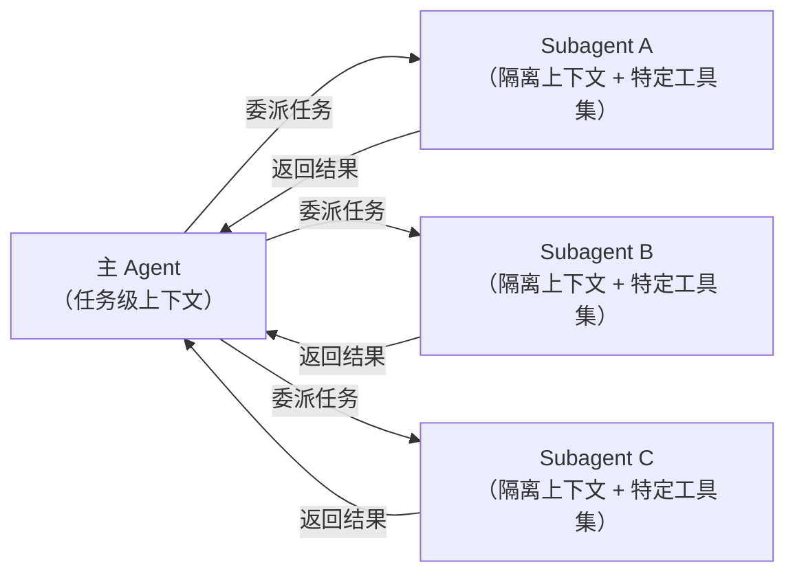
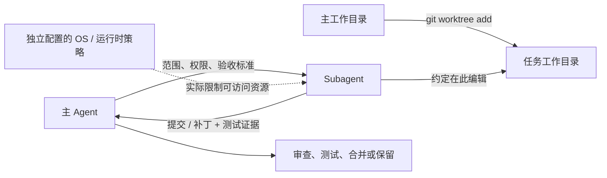
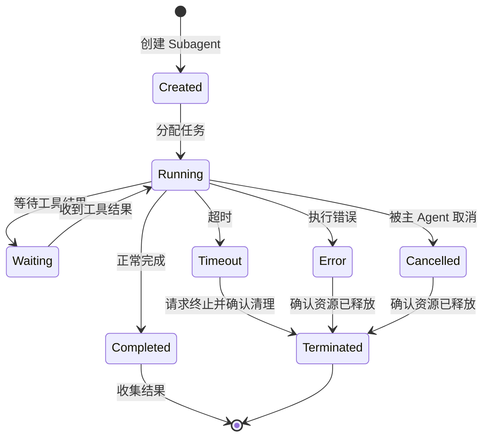



## 引言

把“实现接口、更新调用者、编写测试、独立审查”交给四个 Agent，看起来获得了四倍工作能力；但调用者可能依赖尚未确定的接口，测试可能验证旧代码，两个工作树的补丁还可能各自通过、合并后失败。真正的问题不是能否同时启动四个会话，而是**哪些工作可以独立推进，什么结果有资格进入共同产物，以及并行收益是否大于协调成本**。

**Subagent** 是一种委派模式：主 Agent 将有边界的任务交给具有独立执行上下文的子代理，再接收其结果。它可以减少主上下文中的中间信息；只有任务可并行且协调成本可控时，才可能缩短总用时。

Subagent 可以视为多 Agent 系统的一种层次化组织形式，而不是与 Multi-Agent 互斥的类别。本文比较的是“主从委派”和“同级协作”两种控制结构。

### 问题与阅读指南

本文先区分隔离维度，再以依赖图分析是否值得拆分，随后推导结果接纳、冲突和失败策略；最后用小型编排代码说明取消与收集的可测试契约。建议先理解 Harness 的工具授权和运行时边界；本文不把子代理数量、工作目录或一个超时参数视为安全保证。

## Subagent 的多维定义

### 什么算一个 Subagent

不同框架的命名并不完全一致。本文用以下三项描述子代理的设计契约，而不把它们当作所有产品都满足的定义：



1. **上下文隔离**：Subagent 拥有独立的上下文窗口，减少主上下文的中间信息；返回结果仍需校验
2. **工具限制**：应按子任务授予最小工具权限，并由运行时执行授权，而不是仅靠提示词约束
3. **明确生命周期**：有清晰的创建、执行、返回、销毁过程

### 主从委派与同级协作

| 维度 | 主从委派（本文的 Subagent 模式） | 同级协作模式 |
|------|---------------------|----------------------|
| 控制流 | 以委派与收集为主，也可有中间消息 | 以协作、协商为主 |
| 上下文 | 通常分开维护，按契约返回结果或中间信息 | 可共享，也可分别维护并传递消息 |
| 决策权 | 主 Agent 负责整体决策，子代理可在授权范围内自主行动 | 按协调协议分配 |
| 并行性 | 独立子任务可以并行，依赖任务仍需排序 | 取决于依赖关系与协调方式 |
| 适用场景 | 独立子任务分解 | 需要相互审查/辩论的任务 |

## 隔离模型

### 三个相互独立的隔离维度

| 维度 | 解决的问题 | 不提供的保证 |
|------|------------|--------------|
| 上下文隔离 | 控制子代理输入和回传信息的范围，减少中间日志占用 | 不阻止工具读取共享磁盘，不自动防止提示注入或泄密 |
| 工作副本隔离 | 将不同任务的源文件修改放在不同目录或分支 | 不限制进程访问目录外的文件、网络或凭据 |
| 执行权限隔离 | 由操作系统或运行时约束文件、网络、进程与资源访问 | 不保证任务正确，也不替代输出审查与外部副作用管理 |

这些维度需要分别配置，而不是从“独立上下文”自然升级到“安全沙箱”。单独启动一个进程不会自动削减其权限；容器也不会自动断网或获得独立内核。需要运行不可信代码时，应先按 Harness 的威胁模型选择并验证执行边界。

### Git worktree：工作副本隔离，不是进程沙箱

Git worktree 允许一个仓库关联多个工作目录；每个工作树有自己的索引与 `HEAD` 等状态，但共享仓库对象和部分引用。这适合把并行任务的改动分开管理。[Git worktree 官方文档](https://git-scm.com/docs/git-worktree)



关键边界如下：

- **改动分离**：在各自工作树内的普通源文件编辑不会直接改写另一工作树的对应文件，但合并仍可能发生冲突。
- **不是权限隔离**：工作目录设置不阻止进程通过绝对路径访问主仓库、用户目录、共享凭据或网络。
- **不是副作用回滚**：删除工作树不能撤回已发送消息、已部署服务、数据库写入或工作树外的文件改动。
- **不是共享资源互斥**：Git 公共元数据、端口、数据库和缓存仍可能需要协调。

Claude Code 的子代理提供独立上下文与工具权限配置，但这些配置应与实际运行环境一起核查，不能从“使用 worktree”推导出“仅能看见 worktree”。产品接口会变化，部署时应核对对应版本文档。[Claude Code 子代理文档](https://code.claude.com/docs/en/sub-agents)

## 先画依赖图，再决定开几个 Agent

将任务表示为有向无环图 G=(V,E)：节点是有独立验收条件的工作，边 A→B 表示 B 必须使用 A 的产物。这里的依赖不只包括文件，还包括接口约定、需求确认和可用测试环境。把节点分配给不同 Agent 不会消除边。

设节点耗时为 tᵢ，P 个执行槽位，共计工作量 W=Σtᵢ，关键路径长度 L 为最长依赖路径上的耗时和。在节点不可拆分、依赖固定、没有协调开销的简化条件下，完成时间至少为 `max(W/P, L)`。这是工作量与依赖顺序给出的下界，不是排程算法必能达到的预测。

例如，假设 A 确定接口耗时 6 个单位，B 实现接口耗时 4，C 更新调用者耗时 4，D 集成测试耗时 2；依赖为 A→B、A→C、B→D、C→D。串行工作量为 16，关键路径 A→B→D 为 12。两个槽位在这一特定图上可达到 12，增加到四个也不能短于 12。**同一节点集合下，并行度受依赖限制；增加执行者不等于缩短关键路径。** 这些是人为设定的抽象时间单位，不是模型速度实测。

真实比较还要计入派发 D、上下文重建 C、合并 M 与返工 R。对于确实位于串行前后阶段的这些开销，可写成 `T_total = D + C + T_schedule + M + R`；若它们与执行重叠，就应作为图中的节点，而不是机械相加。只有节省的执行等待大于新增开销，拆分才会降低端到端时延。总 token 成本则可能同时上升，因为多个执行者重复读取同一背景。

### 三种拓扑为何没有统一胜者

| 拓扑 | 适合的依赖结构 | 主要代价 | 应观察什么 |
| --- | --- | --- | --- |
| 单执行者 | 接口未稳定、每一步依赖上一步判断 | 并行机会被放弃，但共享理解成本低 | 关键路径时间、上下文是否失控 |
| 主从扇出再汇总 | 独立检索、互不重叠的实现或独立审查 | 重复背景、尾部慢任务、汇总瓶颈 | 最慢子任务、合并返工、总调用量 |
| 按 DAG 分阶段委派 | 依赖可以显式表达、阶段产物可验收 | 调度状态更多，前置失败会阻塞后继 | 错用旧前置产物次数、阻塞时间 |

“研究、开发、测试”是角色标签，不一定是可并行的任务划分。更好的拆分可能是先用一个执行者固定接口，再让实现和测试设计并行，最后用合并后的版本运行测试。若接口仍频繁变化，先减少并行度反而能减少返工。独立审查可以并行读取同一快照，但审查结论必须注明快照版本。

仓库 [examples/agent_tradeoffs](https://github.com/YangCazz/YangCazz.github.io/tree/main/examples/agent_tradeoffs) 用固定时长的离散排程与读写集合做确定性对照。在上述图上，每节点增加 1 单位槽位内派发开销、末尾再加 2 单位合并开销，两槽位耗时变为 17，超过不含这些委派开销的串行基线 16；若串行也支付同样开销，则是 22。这个区分避免把不同基线偷换成并行的普遍劣势。实验验证给定图的依赖及冲突规则，不模拟模型推理质量，也不能据此声称“多 Agent 快了多少”。

## 委派-收集-合并模式

### 基本模式

下面是可运行的异步编排教学示例（Python 3.10+）：注入的 `run` 协程代表任务执行，示例采用 best-effort（尽力收集）策略，只演示独立任务的并发限额、结果收集与协作式超时；不实现前述 DAG 调度。它不调用真实模型，不装载沙箱，也不执行工具授权。

```python
import asyncio
from dataclasses import dataclass
from time import monotonic
from typing import Awaitable, Callable


@dataclass(frozen=True)
class SubagentTask:
    task_id: str
    instruction: str
    timeout_seconds: float = 120


@dataclass(frozen=True)
class SubagentResult:
    task_id: str
    success: bool
    output: str
    elapsed_seconds: float | None


class SubagentOrchestrator:
    def __init__(self, run: Callable[[SubagentTask], Awaitable[str]],
                 max_parallel: int = 4):
        if max_parallel < 1:
            raise ValueError("max_parallel must be positive")
        self.run = run
        self.semaphore = asyncio.Semaphore(max_parallel)

    async def delegate_all(self, tasks: list[SubagentTask]):
        if len({task.task_id for task in tasks}) != len(tasks):
            raise ValueError("duplicate task_id")
        if any(task.timeout_seconds <= 0 for task in tasks):
            raise ValueError("timeout must be positive")
        # 子任务自行取消被收集；父调用取消仍由 gather 向下传播。
        results = await asyncio.gather(
            *(self._run_one(task) for task in tasks), return_exceptions=True
        )
        return [SubagentResult(task.task_id, False, "child cancelled", None)
                if isinstance(result, asyncio.CancelledError) else result
                for task, result in zip(tasks, results)]

    async def _run_one(self, task: SubagentTask) -> SubagentResult:
        # 教学口径：计时与超时从取得并发槽位后开始，不含排队。
        async with self.semaphore:
            started = monotonic()
            try:
                output = await asyncio.wait_for(
                    self.run(task), timeout=task.timeout_seconds
                )
                success = True
            except asyncio.TimeoutError:
                output, success = "cooperative timeout", False
            except Exception as exc:
                output, success = f"task failed: {type(exc).__name__}", False
            # 不捕获 CancelledError：主任务取消继续向上传播。
            return SubagentResult(task.task_id, success, output,
                                  monotonic() - started)

```

`asyncio.wait_for` 会请求取消协程并等待取消完成；若协程吞掉取消、阻塞事件循环或启动了外部进程，它并不构成硬执行期限，也不会自动杀死进程树。真实系统应另外实现运行时终止、清理与验证。[Python asyncio 文档](https://docs.python.org/3/library/asyncio-task.html#asyncio.wait_for)

### 收集政策必须先于并发代码确定

三种常见政策不能只靠换一个收集函数来混用：

| 政策 | 一个子任务失败后 | 完成条件 |
| --- | --- | --- |
| best-effort | 保留独立兄弟任务，收集部分结果 | 所有任务已结束，逐项标出成功、失败或取消 |
| fail-fast | 若共同目标已不可实现，取消仍运行的相关任务 | 取消与清理确认后，返回失败及已有证据 |
| quorum | 足够独立且合格的结果到达后停止其余工作 | 预先定义的证据门槛成立，而非简单多数文本一致 |

上面代码选择第一种。普通异常由 `_run_one` 转成失败结果；子任务自行抛出 `CancelledError` 则由 `gather(return_exceptions=True)` 收集后转换为取消项，耗时记为未知而非伪造 0。若调用 `delegate_all` 的父任务被取消，`gather` 的取消仍会传播到未完成子任务，父调用不应返回一份看似完整的结果列表。[Python 的 gather 契约](https://docs.python.org/3.10/library/asyncio-task.html#asyncio.gather)

二者必须分别测试。旧式 `gather` 加 `except Exception` 容易遗漏子任务取消：调用者收到取消异常，而兄弟任务仍继续运行。本文的回归测试直接执行 Markdown 中的代码，分别注入子任务自行取消、父任务取消及等待并发槽位时的取消；它们检验协程协议，不证明外部进程已经终止。

### 合并是一项版本化验收，不是文本拼接

每个委派至少应交付一个结果信封：任务 ID 与代次、基线提交 `base_sha`、读取的前置产物版本、补丁或结论、执行过的验证及其目标版本、未完成项。父代理接收“测试通过”却不知道测试在哪个快照运行，不能把它作为当前分支的验收证据。

考虑两个子代理都从 a1 开始：A 将 `api.py` 中的返回类型从字符串改为对象，B 修改 `client.py` 并假设返回类型仍是字符串。两个补丁没有文本冲突，却存在语义冲突。只比较写入文件集合 W 不够；还要考虑读取依赖 R。若 `W_A ∩ (R_B ∪ W_B)` 非空，或对称条件成立，就应将其标为需要串行核对的候选冲突。文件级读写集是保守近似：可能把互不相关的函数误报为冲突，也可能漏掉未声明的外部依赖。

一个可操作的合并协议如下：

1. 固定共同基线与验收条件；限定每个子任务的写入责任，记录跨任务依赖。
2. 子代理只交付补丁和局部验证，不直接把共享目标标为完成。
3. 集成者核对任务代次、基线、前置版本和读写交叉。基线变更时重新审查，不能只相信“补丁可干净应用”。
4. 在候选合并版本上运行跨接口测试；局部通过记录仍保留，但不替代集成验收。
5. 以版本前置条件更新共享目标。若目标已被别人推进，重新核对，而不是覆盖。

完全串行合并降低并发冲突，却把集成者变成瓶颈；乐观并行适合冲突稀少且返工便宜的任务；高耦合文件采用单写者能减少竞争，但会牺牲并行机会。选择依据应是冲突率、返工成本和关键路径，而不是偏好某一种团队组织形式。

## Subagent 生命周期管理

委派不能扩大授权：子代理权限应是主任务已获授权范围与子任务必要权限的交集；子代理的请求或产物也不能替代用户批准。接收结果时还应核对任务 ID、任务版本和取消状态；取消后或约束更新前产生的晚到结果只能作为待审查材料，不能自动提交改动或触发外部动作。上面的教学代码仅检查任务 ID 唯一性，未实现持久任务版本与晚到结果拒收。

结果合并不等于正确性验证。即使多数子代理给出相同结论，也可能共享同一错误来源；交付时应保留来源、补丁和测试证据，按任务验收标准独立检查。

### 状态机



状态图描述目标生命周期，不代表上面的协程示例实现了全部状态。终止请求、实际退出和副作用核查应分别记录；确认未完成时不能把状态标记为已清理。

### 资源限制与超时

```python
# Subagent 的资源限制配置
SUBAGENT_LIMITS = {
    "max_turns": 20,           # 最大 Agent 循环轮数
    "max_tokens": 8000,        # 最大消耗 token 数
    "max_time_seconds": 120,   # 最大执行时间
    "max_tool_calls": 15,      # 最大工具调用次数
    "max_output_tokens": 2000, # 返回结果的最大长度
}
```

上述字典仅声明预算；必须由相应执行层计量并落实，声明本身不会限制资源。

**超时后的处理契约**：
1. 请求协作式取消，停止派发新工具调用，并保留已有证据。
2. 若运行时支持硬终止，终止该任务拥有的执行进程并等待退出；未确认退出则继续标记为终止中。
3. 返回部分结果并标注未完成项；独立核查网络请求、部署等无法随进程退出自动回滚的副作用。

## 怎样证明拆分值得，而不是只证明任务跑完了

本文建议比较单执行者、独立扇出与依赖感知调度三种配置，保持任务、模型、总预算、工具权限和最终验收一致。记录端到端完成时间，也记录每个节点的排队、执行、汇总与返工时间；单独观察总 token、人工介入以及最终合并结果。若只展示各子代理的局部成功，会漏掉最重要的系统性失败。

受控反例可以比再增加正常任务更快暴露契约缺口：让两个补丁无文本冲突但接口不兼容；让一个审查结果基于旧基线晚到；让关键前置失败而独立任务仍可完成；让子任务自行取消而父任务继续等待。每种情形的预期都应在运行前写明：重验、拒收、局部保留还是级联取消，而非事后由汇总模型解释成成功。

随文排程实验和协程测试只覆盖确定性的控制性质。要验证“独立审查改善质量”，还需真实任务上的重复试验，以及与相同预算单执行者的比较；多个代理共享模型、提示和资料时，错误并不独立，多数一致不能自动增加证据强度。

因此，一项工作适合委派的判据不是“它很大”，而是：**输入边界能说清，产物能独立验收，依赖能显式传递，节省的等待足以支付交接与返工。** 缺少其中一项时，先缩小并行范围往往比继续增加代理更有价值。

## 总结

Subagent 是组织复杂任务的一种选择，并不必然要求分布式部署，也不保证优于单 Agent。它的核心设计空间由三个轴定义：

1. **隔离维度**：上下文、工作副本与执行权限分别设计
2. **编排模式**：从简单并行到 DAG 依赖编排
3. **生命周期**：从即抛型到长期存活型

本篇负责“谁做什么、结果怎样组合”。下一篇 [上下文与有效工作状态]() 则处理交接中更细的问题：一条证据到了新执行者手里，为什么仍然有效，何时必须失效，以及压缩后还能否支撑同一个判断。

---

## 参考文献

<ol class="references">
<li>Anthropic. <a href="https://code.claude.com/docs/en/sub-agents">Create custom subagents</a></li>
<li>Git. <a href="https://git-scm.com/docs/git-worktree">git-worktree</a></li>
<li>Python. <a href="https://docs.python.org/3/library/asyncio-task.html#asyncio.wait_for">Coroutines and Tasks: asyncio.wait_for</a></li>
</ol>


